```{r setup, include = FALSE}
knitr::opts_chunk$set(echo = FALSE)
library(webexercises)
```


```{r, echo = FALSE, results='asis'}
# Uncomment to change widget colours:
#style_widgets(incorrect = "goldenrod", correct = "purple")
```

## Angle facts

The four angles inside a **quadrilateral** add up to `r fitb(360)` degrees.

**Opposite angles in a parallelogram** `r mcq(c("add up to 180 degrees","are unrelated",answer="are equal"))`.

**Co-interior** angles `r mcq(c(answer="add up to 180 degrees","are unrelated","are equal"))`.

<hr>

### Question A1

<hr>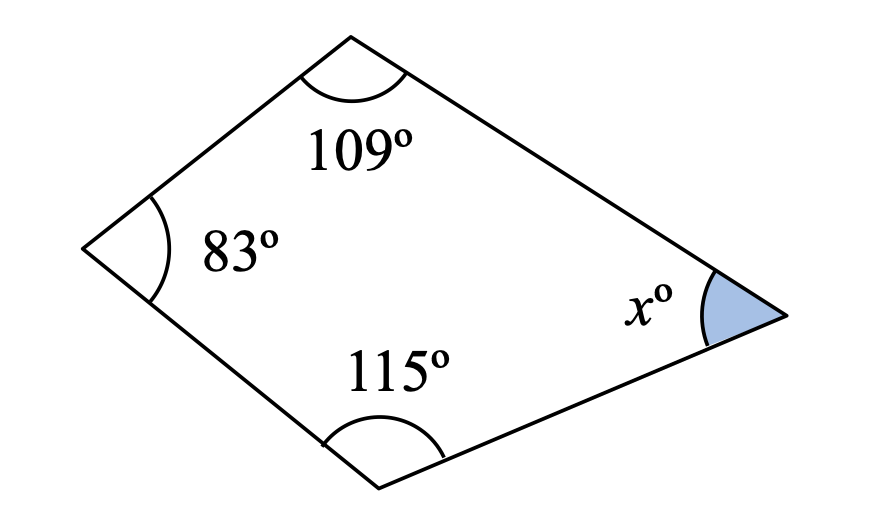


Angle $x$ is `r fitb(53)` degrees.

<hr>

### Question A2

<hr>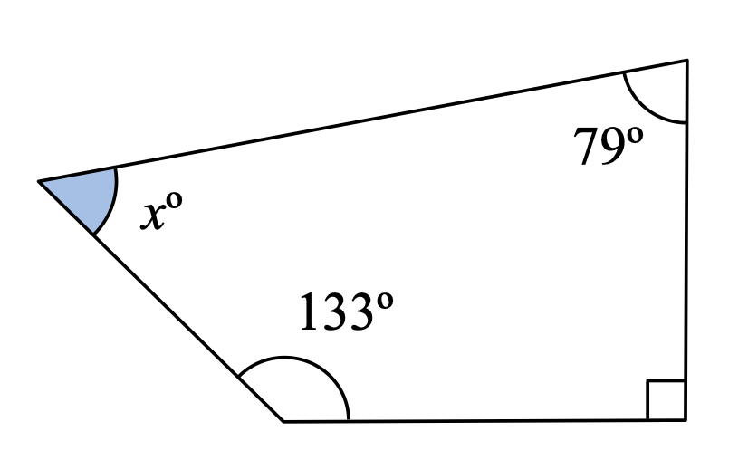

Angle $x$ is `r fitb(58)` degrees.

<hr>

### Question A3

<hr>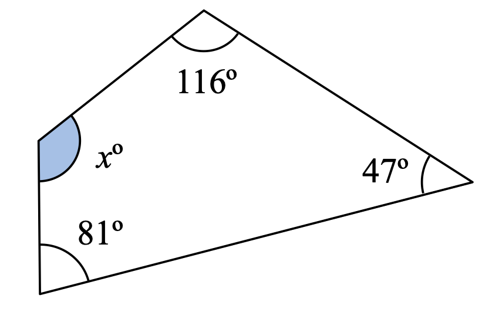

Angle $x$ is `r fitb(116)` degrees.

<hr>

### Question A4

<hr>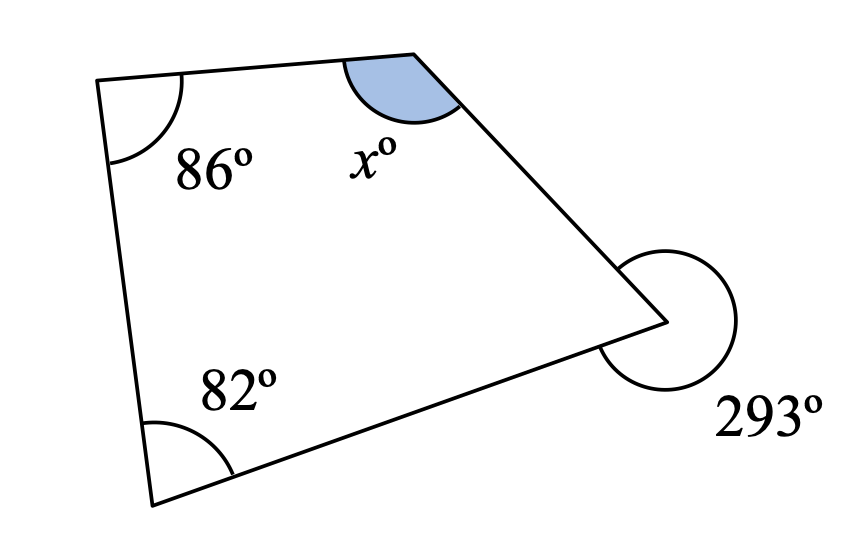

Angle $x$ is `r fitb(125)` degrees.

<hr>

### Question B1

<hr>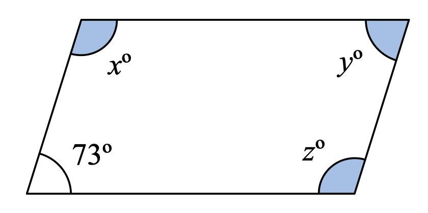

Angle $x$ is `r fitb(107)` degrees.

Angle $y$ is `r fitb(73)` degrees.

Angle $z$ is `r fitb(107)` degrees.

<hr>

### Question B2

<hr>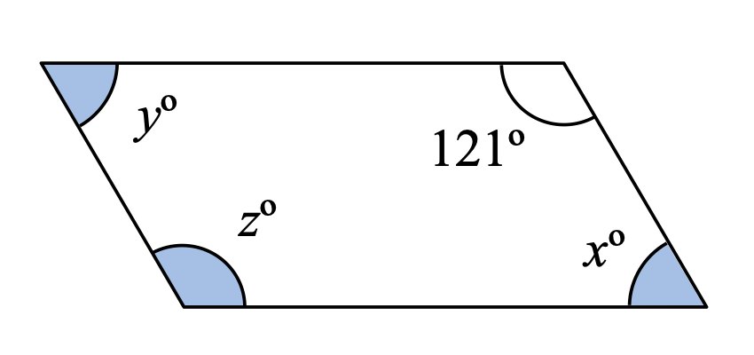

Angle $x$ is `r fitb(59)` degrees.

Angle $y$ is `r fitb(59)` degrees.

Angle $z$ is `r fitb(121)` degrees.

<hr>

### Question B3

<hr>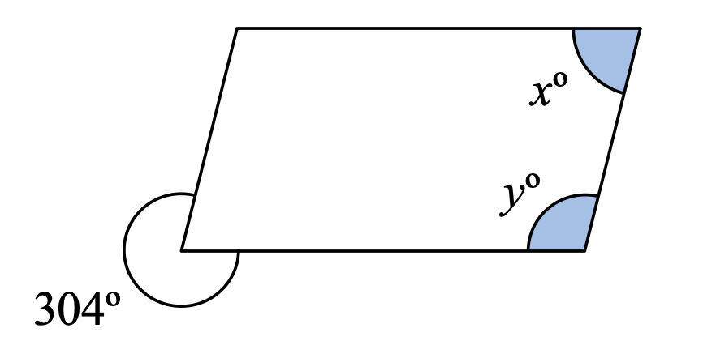

Angle $x$ is `r fitb(56)` degrees.

Angle $y$ is `r fitb(124)` degrees.


<hr>

### Question B4

<hr>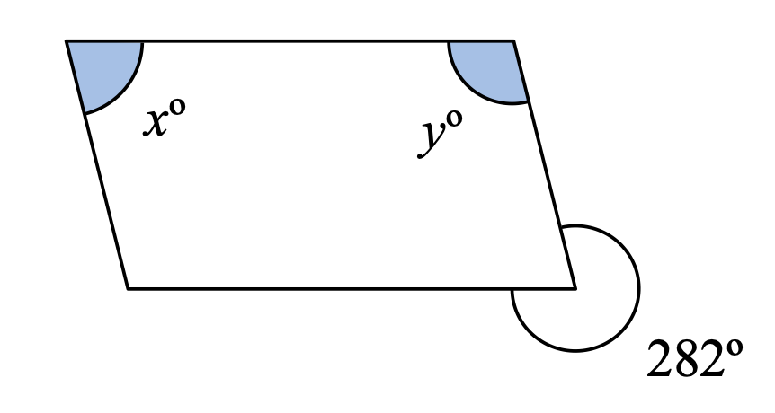

Angle $x$ is `r fitb(78)` degrees.

Angle $y$ is `r fitb(102)` degrees.


<hr>

### Question C1

<hr>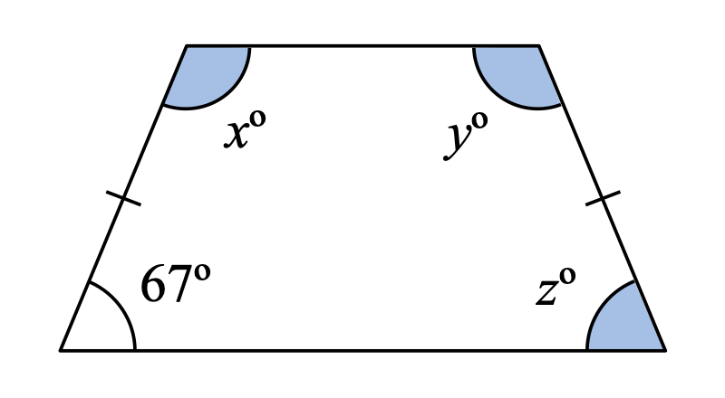

Angle $x$ is `r fitb(113)` degrees.

Angle $y$ is `r fitb(113)` degrees.

Angle $z$ is `r fitb(67)` degrees.

<hr>

### Question C2

<hr>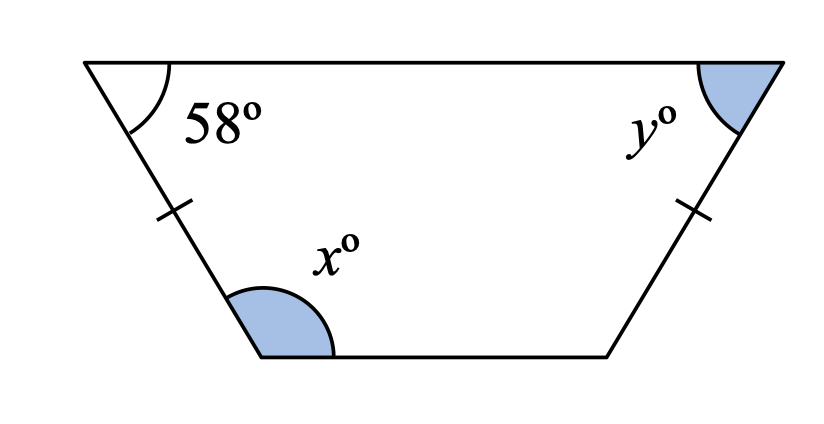

Angle $x$ is `r fitb(122)` degrees.

Angle $y$ is `r fitb(58)` degrees.


<hr>

### Question C3

<hr>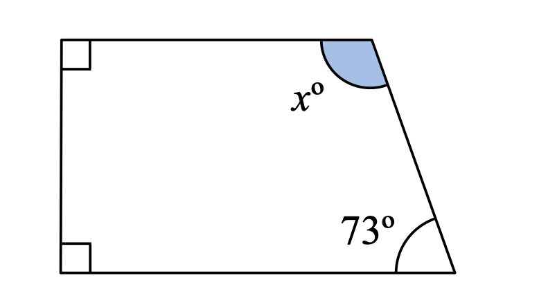

Angle $x$ is `r fitb(107)` degrees.

<hr>

### Question C4

<hr>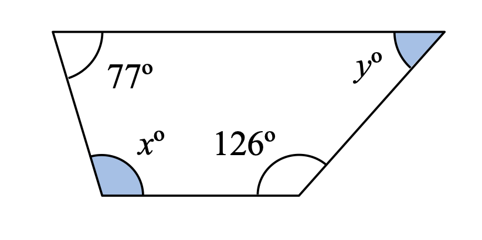

Angle $x$ is `r fitb(103)` degrees.

Angle $y$ is `r fitb(54)` degrees.

