```{r setup, include = FALSE}
knitr::opts_chunk$set(echo = FALSE)
library(webexercises)
```


```{r, echo = FALSE, results='asis'}
# Uncomment to change widget colours:
#style_widgets(incorrect = "goldenrod", correct = "purple")
```

`r hide("Data Booklet")`

[Click here](https://www.sqa.org.uk/files_ccc/ah-statistics-data-booklet.pdf) to open the Data Booklet.


`r unhide()`

<hr>

## 1 Exploratory Data Analysis

<hr>

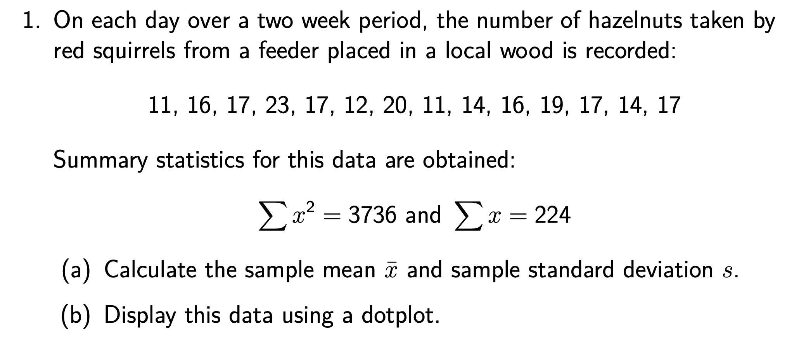

`r hide("Hint")`

The data booklet contains a formula for calculating $S_{xx}$ using the sums given, and a formula for calculating $s$ from $S_{xx}$ and the sample size.

`r unhide()`

`r hide("Answer")`

(a) $\bar{x}=\text{16}$ and $s=\text{3.42}$

(b) Dotplot with x-axis labelled as "number of hazelnuts".

`r unhide()`

`r hide("Solution")`


`r unhide()`

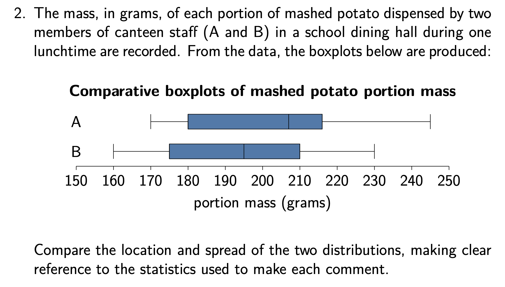

`r hide("Hint")`

Make sure each comment references the *context* (mass of a portion). Do not be afraid to comment that one or more measure is *broadly similar* - if there is no clear difference, say so!

`r unhide()`

`r hide("Answer")`

On average staff member A gave a higher mass of mashed potato per portion, since the median mass was higher.

The consistency of portion mass between the two canteen staff was similar, since the boxplots show similar interquartile ranges.


`r unhide()`

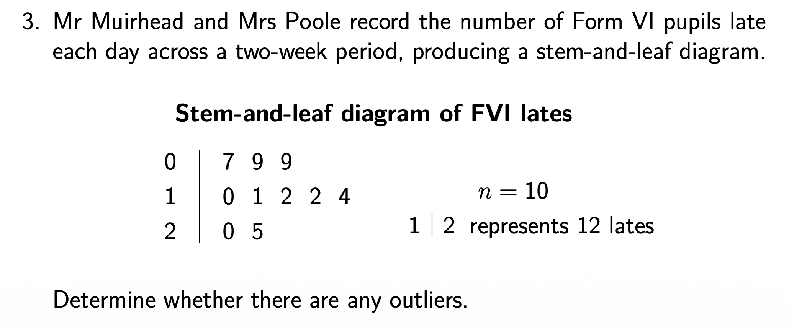

`r hide("Hint")`

Make sure you learn how to calculate the *upper fence* and the *lower fence* from a set of values, and make a numerical comparison when making a conclusion.

`r unhide()`

`r hide("Answer")`

Lower fence = 1.5 and upper fence = 21.5.\newline Since $\text{25}>\text{21.5}$ the value of 25 is an outlier.

`r unhide()`

`r hide("Solution")`


`r unhide()`

<hr>

## 2 Probability Theory I

<hr>

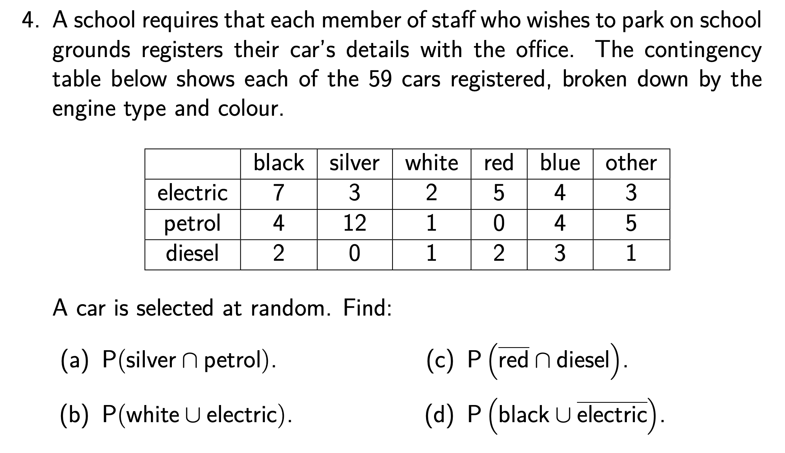

`r hide("Hint")`

$\cap$ (the *intersection*) means that *both conditions must apply*.

$\cup$ (the *union*) means that *at least one condition must apply*.

$\bar{A}$ means **not** $A$.

`r unhide()`

`r hide("Answer")`

(a) $\text{P}(\text{silver}\cap\text{petrol})=\dfrac{\text{12}}{\text{59}}$
(b) $\text{P}(\text{white}\cup\text{electric})=\dfrac{\text{26}}{\text{59}}$
(c) $\text{P}\left(\overline{\text{red}}\cap\text{diesel}\right)=\dfrac{\text{7}}{\text{59}}$.
(d) $\text{P}\left(\text{black}\cup\overline{\text{electric}}\right)=\dfrac{\text{42}}{\text{59}}$.

`r unhide()`

`r hide("Solution")`


`r unhide()`


`r hide("Hint")`

Make sure you memorise the *addition rule* for probability:

$\text{P}(A\cup B)=\text{P}(A)+\text{P}(B)-\text{P}(A\cap B)$

What does *'exhaustive'* tell us?

`r unhide()`

`r hide("Answer")`

$\text{P}(\text{X}\cap \text{Y})=\text{0.08}$

`r unhide()`

`r hide("Solution")`


`r unhide()`

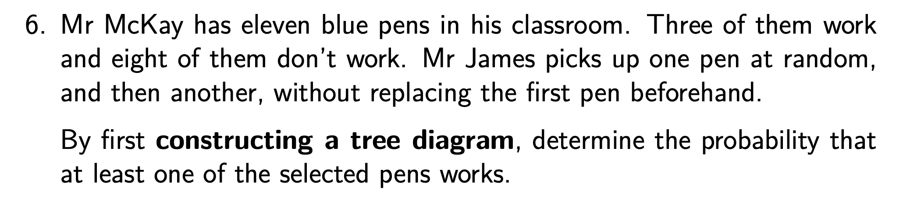

`r hide("Hint")`

Once one of the 11 pens has been selected, it is *not replaced* before the second is selected. 
This means there are only 10 pens available to select the next time.

`r unhide()`

`r hide("Answer")`

$\text{P}(\text{at least one pen works})=\dfrac{\text{27}}{\text{55}}$ or 0.4909

`r unhide()`

`r hide("Solution")`


`r unhide()`

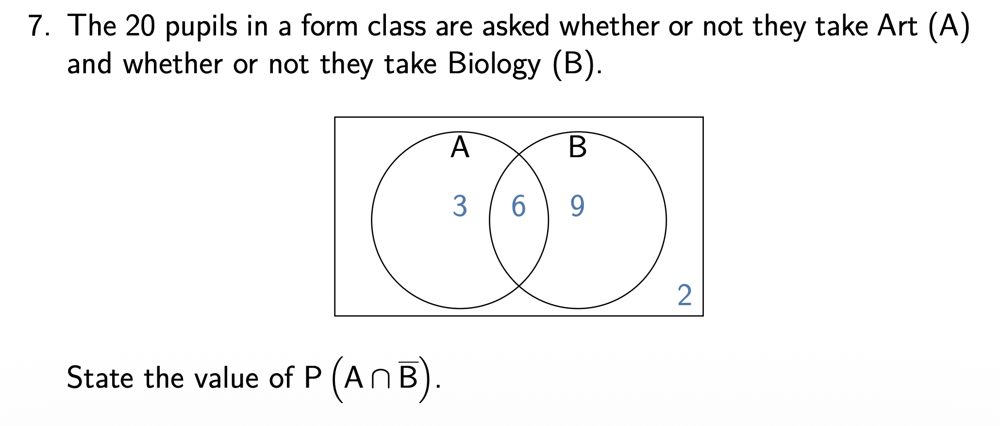

`r hide("Hint")`

Identify the parts of the Venn diagram which **are in A** and, separately, the parts of the diagram which are **not in B**.

Which part lies in the *intersection* of those conditions?

`r unhide()`

`r hide("Answer")`

$\text{P}(\text{A}\cap\overline{\text{B}})=\dfrac{\text{3}}{\text{20}}$ or 0.15

`r unhide()`

`r hide("Solution")`


`r unhide()`

<hr>

## 3 Sampling Theory

<hr>

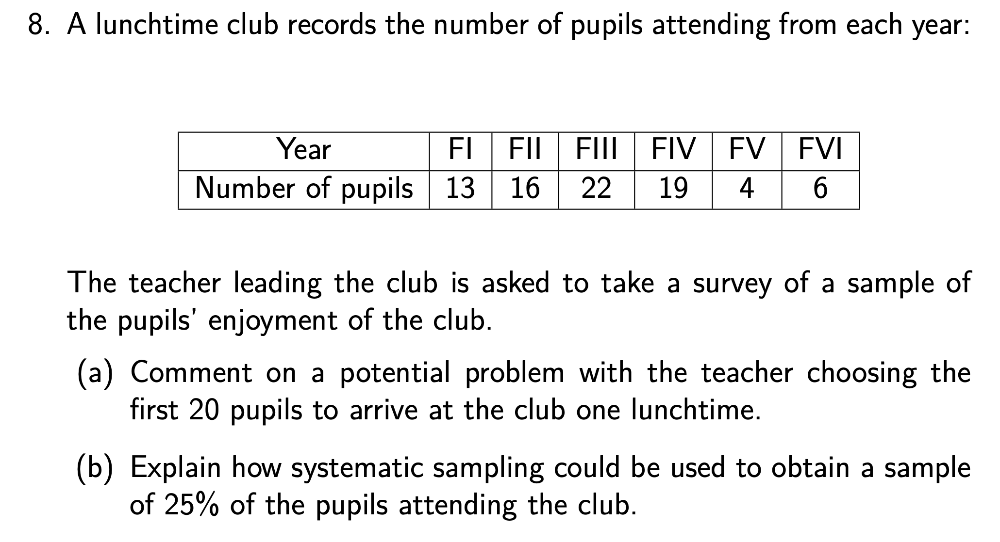

`r hide("Hint")`

When describing sampling methods, be *very clear* on each step needed. 

If you start on pupil 54, for example, and sample every 4, what will you do when you do after reaching pupil number 78?

`r unhide()`

`r hide("Answer")`

(a) This is a \textbf{non-random} sampling method which \textbf{may introduce bias} into the sample, such as if those pupils who enjoy the club most arrive first.

(b) Obtain a numbered list of all of the 80 pupils, then use a random number generator to select a number between 1 and 80. Select the pupil corresponding to that number as the starting point, and then select every 4th pupil, looping back around if needed until a sample of 20 pupils has been obtained.

`r unhide()`


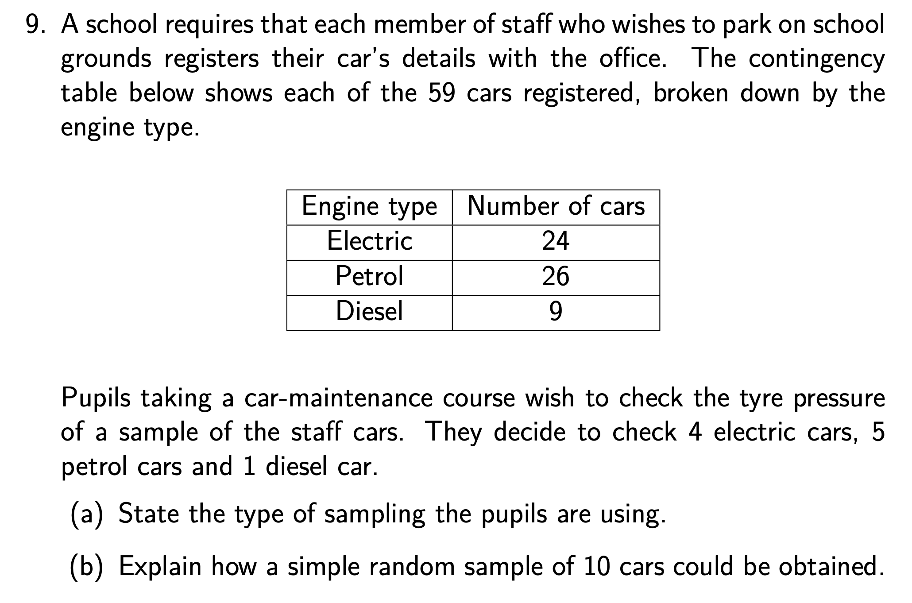

`r hide("Hint")`

Since *simple random sample* is so... simple... take the time to be more explicit with the steps that might not be covered in detail for other random sampling methods.

`r unhide()`

`r hide("Answer")`

(a) Quota sampling.

(b) Obtain a numbered list of the cars. Select ten different random numbers from 1 to 59 using a random number generator, and then choose the ten cars corresponding to those numbers to make the sample of cars to be checked.

`r unhide()`

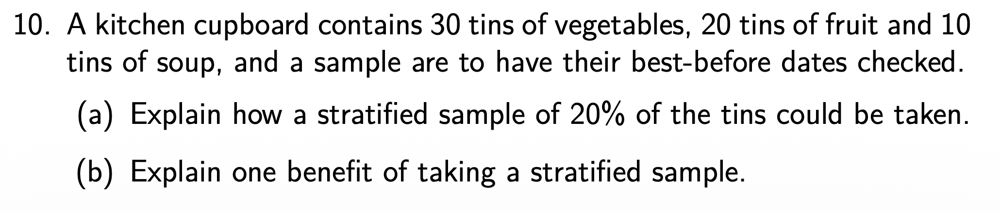

`r hide("Hint")`

If enough information is given to work out the *number sampled* for each stratum, do so!

`r unhide()`

`r hide("Answer")`

(a) Make a numbered list of tins for each category. Use a random number generator to select 6 tins of vegetables, 4 tins of fruit and 2 tins of soup. Together, these make a stratified sample of 20\% of the tins.

(b) Stratified samples tend to be more representative of the populations they are taken from, as they include proportional amounts from each stratum.

`r unhide()`

<hr>

## 4 Probability Theory II

<hr>

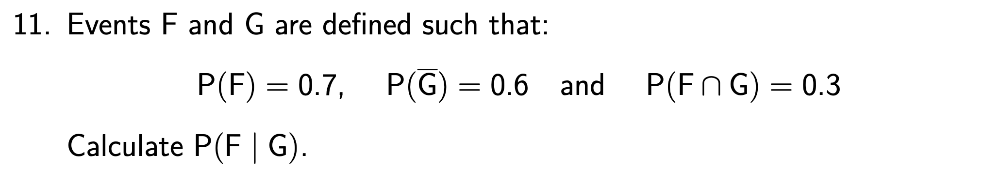

`r hide("Hint")`

Remember to learn the formula for *conditional probability*:

$\text{P}(A\mid B)=\dfrac{\text{P}(A\cap B)}{\text{P}(B)}$

`r unhide()`

`r hide("Answer")`

$\text{P}(\text{F}\mid \text{G})=\frac{3}{4}$ or 0.75

`r unhide()`

`r hide("Solution")`


`r unhide()`

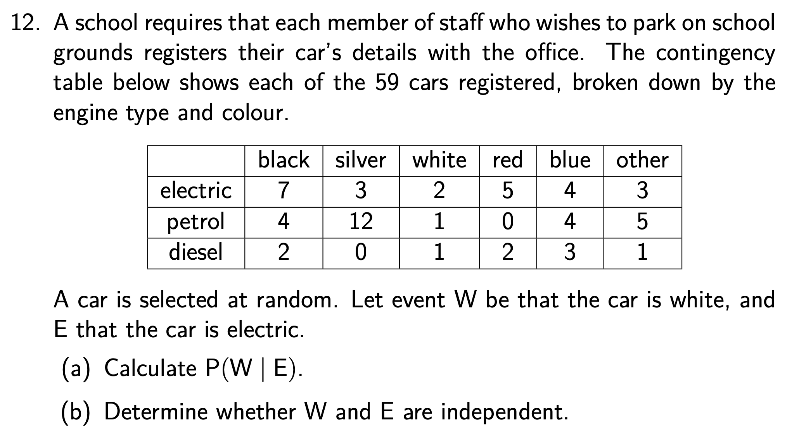

`r hide("Hint")`

(a) It is typically simpler to obtain the numerator and denominator for the conditional probabiity direction *from the table*, rather that using the formula.

(b) Events $A$ and $B$ are independent if $\text{P}(A\mid B)=A$.

`r unhide()`

`r hide("Answer")`

(a) $\text{P}(\text{W}\mid \text{E})=\frac{\text{1}}{\text{12}}$
(b) $\text{P}(\text{W})=\frac{\text{4}}{\text{59}}$. Since  $\text{P}(\text{W})\ne\text{P}(\text{W}\mid \text{E})$, W and E not independent.

`r unhide()`

`r hide("Solution")`


`r unhide()`


`r hide("Hint")`

When given a condition such as $\text{P}(B\mid A)$ and you want $\text{P}(A\mid B)$, you can either:

- use a two step method to use the regular conditional probability formula, or...

- use Bayes' Theorem $\text{P}(A\mid B)=\dfrac{\text{P}(B\mid A)\times \text{P}(A)}{\text{P}(B)}$

`r unhide()`

`r hide("Answer")`

$\text{P}(\text{X}\mid \text{Y})=\text{0.3429}$

`r unhide()`

`r hide("Solution")`


`r unhide()`

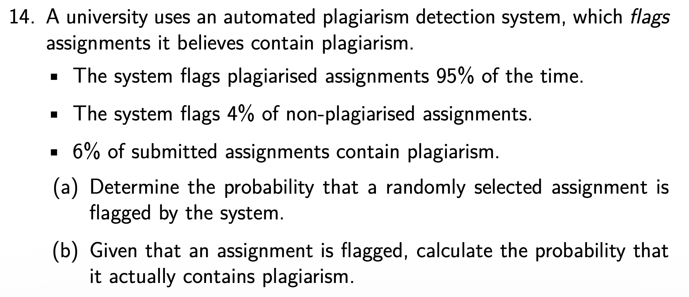

`r hide("Hint")`

Construct a tree diagram!

You are ultimately looking to find $\text{P}(\text{plagiarism}\mid\text{flagged})$.

`r unhide()`

`r hide("Answer")`

(a) 0.0946
(b) 0.6025

`r unhide()`

`r hide("Solution")`


`r unhide()`

<hr>

## 5 Linear Regression I

<hr>

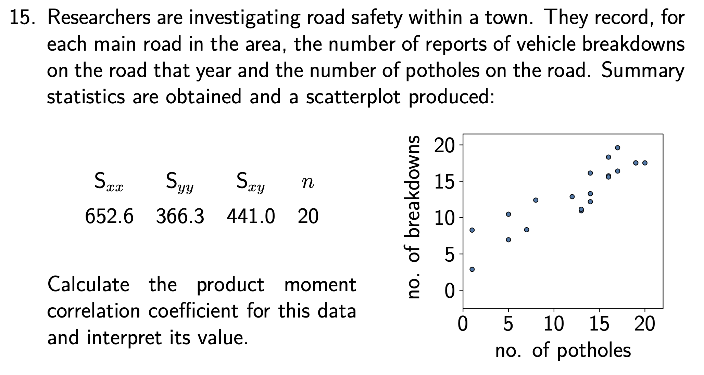

`r hide("Hint")`

The data booklet contains the formula for the correlation coefficient, $r$.

Take care to not miss out any key words in your conclusion.

`r unhide()`

`r hide("Answer")`

The value of $r=0.902$ suggests that there is a strong, positive linear relationship between the number of potholes and the number of breakdowns.

`r unhide()`

`r hide("Solution")`


`r unhide()`


`r hide("Hint")`

Formula for calculating $a$ and $b$ are in the data booklet, leading to the regression line:

$\hat{y}=a+bx$

`r unhide()`

`r hide("Answer")`

(a) Since the scatterplot appears to show a positive linear relationship between the number of coffees sold and queuing time, a linear model seems suitable.

(b) $\hat{y}=2.638+0.723x$

(c) Correlation is not causation. Just because there may be a linear relationship between coffees sold and queuing time does not mean that the number of coffees being sold is causing the queue to be longer or shorter.

(d) For 9 coffees sold the predicted queue time is 9.14 minutes, and for 29 coffees sold the predicted queue time is 23.59 minutes. The estimate for 9 coffees is interpolation, which tends to be more reliable than the extrapolation used for the estimate for 29 coffees.

`r unhide()`

`r hide("Solution")`


`r unhide()`

<hr>

## 6 Random Variables

<hr>


`r hide("Hint")`

Remember that $\text{E}(X^2)$ and $\text{V}(X)$ are different things!

The following laws needs to be learned:

$\text{E}(aX+b)=a \text{E}(X)+b$

$\text{V}(aX+b)=a^2 \text{V}(X)$

Note that the laws of variance are for **variances**:

`r unhide()`

`r hide("Answer")`

(a) $\text{E}(X)=\text{4.9}$ and $\text{V}(X)=\text{8.49}$.

(b) $\text{E}(\text{3}X-\text{1})=\text{13.7}$ and $\text{V}(\text{3}X-\text{1})=\text{76.41}$.

(c) $\text{E}(\text{3}Y-\text{2}X+\text{5})=\text{7.2}$ and $\text{SD}(\text{3}Y-\text{2}X+\text{5})=\text{7.36}$.

`r unhide()`

`r hide("Solution")`


`r unhide()`

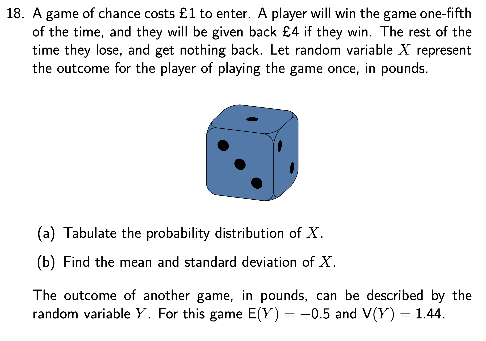

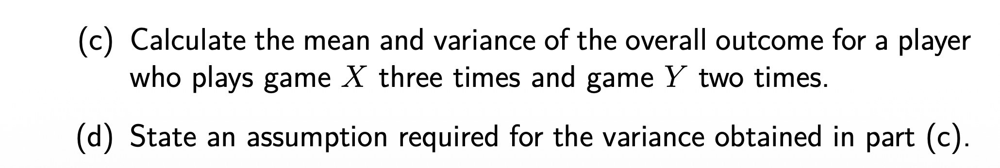

`r hide("Hint")`

Remember never to described the sum of **independent** observations of $X$ as, for example, $3X$.

Instead, three independent observations would be $X_1+X_2+X_3$.

`r unhide()`

`r hide("Answer")`

(a) 

| $x$ | -1 | 3 |
|:---|:---|:---|
|$\text{P}(X=x)$ | 0.8 | 0.2

(b) $\text{E}(X)=-\text{0.2}$ and $\text{SD}(X)=\text{1.6}$.

(c) Let r.v. $T$ represent the total outcome:

$T=X_\text{1}+X_\text{2}+X_\text{3}+Y_\text{1}+Y_\text{2}$.

$\text{E}(T)=-\text{1.6}$ and $\text{V}(T)=\text{10.56}$.

(d) Assume that the outcomes of game $X$ and game $Y$ are independent.

`r unhide()`

`r hide("Solution")`


`r unhide()`

<hr>

## 7 Discrete Distributions

<hr>

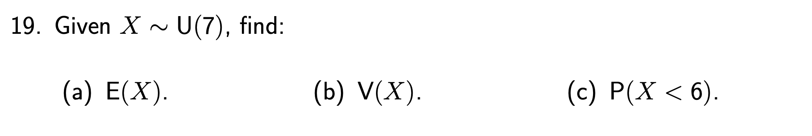

`r hide("Hint")`

Since there is only a **single parameter**, this is a **discrete** uniform distribution $U(k)$.

Make sure you use the correct formulae for the mean and variance.

No calculator functions are available (or needed) for uniform distributions!

`r unhide()`

`r hide("Answer")`

(a) $\text{E}(X)=\text{4}$ 

(b) $\text{V}(X)=\text{4}$ 

(c) $\text{P}(X<\text{6})=\frac{\text{5}}{\text{7}}$

`r unhide()`

`r hide("Solution")`


`r unhide()`


`r hide("Hint")`

**Equals** binomial probability -> **Bpd**

**Less than or equal to** binomial probability -> **Bcd**

`r unhide()`

`r hide("Answer")`

(a) $\text{E}(X)=\text{4.2}$ 

(b) $\text{V}(X)=\text{2.73}$ 

(c) $\text{P}(X>\text{3})=\text{0.6534}$

`r unhide()`

`r hide("Solution")`


`r unhide()`


`r hide("Hint")`

**Equals** Poisson probability -> **Ppd**

**Less than or equal to** Poisson probability -> **Pcd**

`r unhide()`

`r hide("Answer")`

(a) $\text{E}(X)=\text{5.5}$ 

(b) $\text{V}(X)=\text{5.5}$

(c) $\text{P}(X=\text{4})=\text{0.1558}$

`r unhide()`

`r hide("Solution")`


`r unhide()`

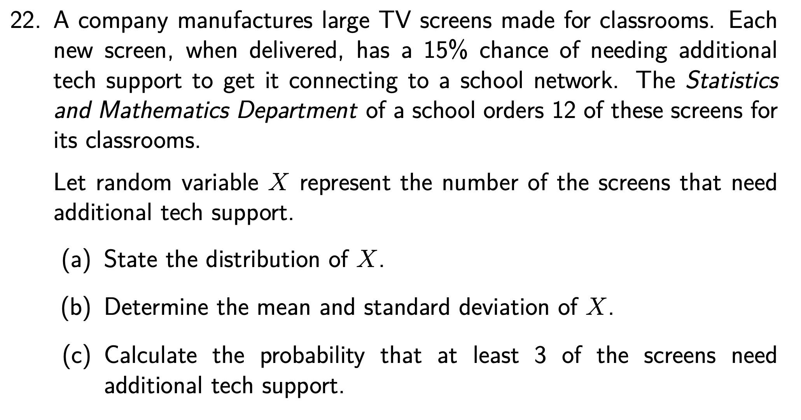

`r hide("Hint")`

Recognising a distribution from a description is an important skill.

Here, there are 12 *trials* (screens purchased), *each* has the same probability of *success* (needing tech support), and we are interested in the number of *successes* from the 12.

`r unhide()`

`r hide("Answer")`

(a) $X\sim \text{B}\left(12,0.15\right)$
   
(b) Mean of $X$ is 1.8 and standard deviation of $X$ is 1.237.
  
(c) $\text{P}(X\geqslant 3)=\text{0.2642}$

`r unhide()`

`r hide("Solution")`


`r unhide()`

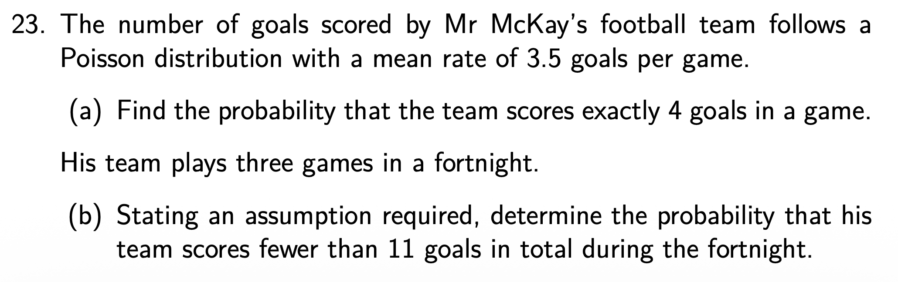

`r hide("Hint")`

Even if the word "Poisson" wasn't included, the phrase *mean rate* hints at Poisson.

Poisson distributions (provided the *assumption* from part (b) is met) combine nicely.

`r unhide()`

`r hide("Answer")`

(a) $\text{P}(X= 4)=\text{0.1888}$

(b) $\text{P}(Y<11)=\text{0.5207}$

`r unhide()`

`r hide("Solution")`


`r unhide()`

<hr>

## 8 Continuous Distributions

<hr>

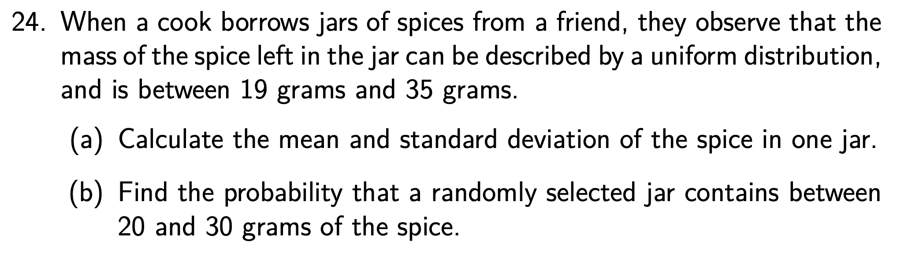

`r hide("Hint")`

Take care once a *uniform* distribution is needed - is it *discrete* or *continuous*?

`r unhide()`

`r hide("Answer")`

(a) Mean 27 grams and standard deviation 4.62 grams.

(b) $\text{P}(20<X<30)=\text{0.625}\text{ or }\frac{\text{5}}{\text{8}}$

`r unhide()`

`r hide("Solution")`


`r unhide()`

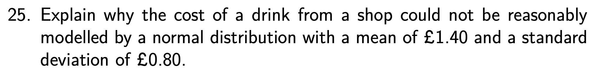

`r hide("Hint")`

A common way of quickly considering what a normal distribution looks like is to imagine its *mean* in the centre and most of the curve lying within **2 standard deviations** from the mean.

Does this make sense in this context?

`r unhide()`

`r hide("Answer")`

Negative values for the cost of a drink would lie within two standard deviations of the mean ($\text{1.40}-\text{2}\times\text{0.80}=-\text{0.20}$).

`r unhide()`

`r hide("Solution")`


`r unhide()`


`r hide("Hint")`

The $Z$ transformation for $X$ is:

$z=\dfrac{x-\mu}{\sigma}$

Remember the calculation functions $P()$ and $Q()$ for normal distributions.

`r unhide()`

`r hide("Answer")`

$\text{P}(X>20)=\text{0.2148}$

`r unhide()`

`r hide("Solution")`


`r unhide()`

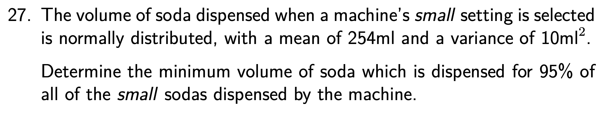

`r hide("Hint")`

**DRAW A SKETCH**. Please.

A sketch with shaded probability and the data booklet leads to a $z$ value.

The $z$ transformation can then be applied.

`r unhide()`

`r hide("Answer")`

248.8ml.

`r unhide()`

`r hide("Solution")`


`r unhide()`


`r hide("Hint")`

Questions involving *combining normal variables* often are worth 6-8 marks, so show your working clearly and don't rush it.

Remember, for example, $X_1+X_2+\ldots +X_8$ or similar.

`r unhide()`

`r hide("Answer")`

$\text{P}(X>120)=\text{0.8708}$

`r unhide()`

`r hide("Solution")`


`r unhide()`


`r hide("Hint")`

If it says **suitable approximation** then you **must** use the *normal approximation*.

You need to learn the specific conditions for a normal approximation to the Binomial, involving $np$ and $nq$.

The approximate ($\approx$) normal distribution should match the *mean and variance* of the original discrete distribution.

Since we are going from a *discrete* distribution to a *continuous* distribution, remember to use a...

`r unhide()`

`r hide("Answer")`

$\text{P}(X\geqslant 15)=\text{0.0016}$

`r unhide()`

`r hide("Solution")`


`r unhide()`


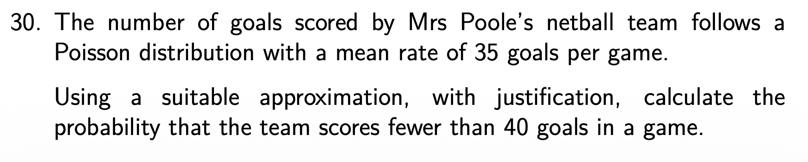

`r hide("Hint")`

If it says **suitable approximation** then you **must** use the *normal approximation*.

You need to learn the specific conditions for a normal approximation to the Poisson involving $\lambda$.

The approximate ($\approx$) normal distribution should match the *mean and variance* of the original discrete distribution.

Since we are going from a *discrete* distribution to a *continuous* distribution, remember to use a...

`r unhide()`

`r hide("Answer")`

$\text{P}(X< 40)=\text{0.7764}$

`r unhide()`

`r hide("Solution")`


`r unhide()`

<hr>

## 9 Distribution of the Sample Mean

<hr>

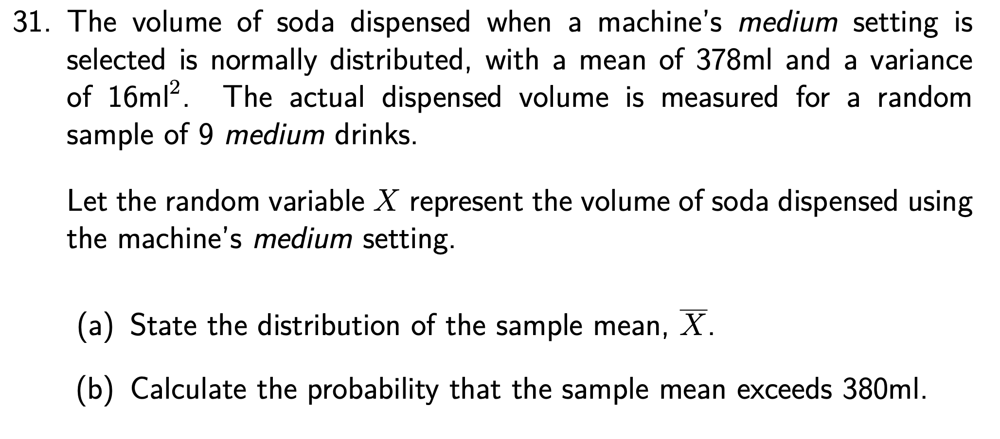

`r hide("Hint")`

The $z$ transformation for a **sample mean** involves $n$.

It may now be familiar as the *test statistic* for a one-sample $z$ test:

$z=\dfrac{\bar{x}-\mu}{\cfrac{\sigma}{\sqrt{n}}}$

`r unhide()`

`r hide("Answer")`

(a) $\overline{X}\sim \text{N}\left(378,\frac{\text{16}}{\text{9}}\right)$

(b) $\text{P}(\overline{X}> 380)=\text{0.0668}$

`r unhide()`

`r hide("Solution")`


`r unhide()`


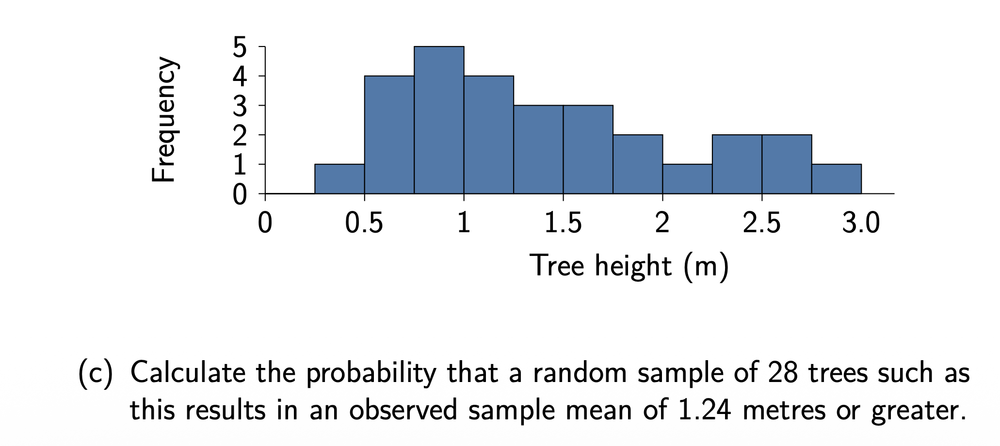

`r hide("Hint")`

Learn what the Central Limit Theorem actually means, rather than just "sample size greater than 20 so CLT something something..."

You'll find it written clearly in your notes.

`r unhide()`

`r hide("Answer")`

(a) $\overline{X}\approx \text{N}\left(1.1,\frac{\text{0.3}^\text{2}}{\text{28}}\right)$

(b) Since the underlying distribution is not known, a sample size greater than 20 helps by allowing the Central Limit Theorem to be invoked, meaning the distribution of the sample mean is approximately distributed anyway.

(c) $\text{P}(\overline{X}> 1.24)=\text{0.0068}$

`r unhide()`

`r hide("Solution")`


`r unhide()`

<hr>

## 10 Hypothesis Testing I

<hr>


`r hide("Hint")`

Since the **population standard deviation is known**, this is a $z$ test.

Pay attention to each of the 6 marks available here - good habits with hypothesis testing will serve you well for the remainder of the course!

`r unhide()`

`r hide("Answer")`

Since $\text{2.00}>\text{1.64}$, reject $\text{H}_{\text{0}}$ at the 5\% level of significance. There is sufficient evidence to suggest that the population mean height of the Christmas trees has increased from 180 centimetres.

`r unhide()`

`r hide("Solution")`


`r unhide()`


`r hide("Hint")`

Since the **population standard deviation is not known**, and the *sample standard deviation*, $s$, will be used instead, this is a $t$ test.

Make sure you refer to $t$ critical values and not $z$ values.

`r unhide()`

`r hide("Answer")`

Assume that the mass of a mince pie is normally distributed. Since $-\text{0.577}>-\text{3.499}$, do not reject $\text{H}_{\text{0}}$ at the 1\% level of significance. There is insufficient evidence to suggest that the population mean mass of a mince pie differs from the stated 60 grams.

`r unhide()`

`r hide("Solution")`


`r unhide()`


`r hide("Hint")`

Since we are looking at a **proportion** this is a $z$ test for proportion.

Practising choosing and performing hypothesis testing carefully puts you on Santa's Nice List.

`r unhide()`

`r hide("Answer")`

$np=\text{120}\times\text{0.9}=\text{108}>5$ and $nq=\text{120}\times\text{0.1}=\text{12}>5$, so a normal approximation is appropriate. Since $-\text{2.13}<-\text{1.28}$, reject $\text{H}_{\text{0}}$ at the 10\% level of significance. There is sufficient evidence to suggest that less than 90\% of children are on the Nice List.

`r unhide()`

`r hide("Solution")`


`r unhide()`

<hr>

## 11 Confidence Intervals

<hr>


`r hide("Hint")`

`r unhide()`

`r hide("Answer")`


`r unhide()`

`r hide("Solution")`


`r unhide()`


`r hide("Hint")`

`r unhide()`

`r hide("Answer")`


`r unhide()`

`r hide("Solution")`


`r unhide()`

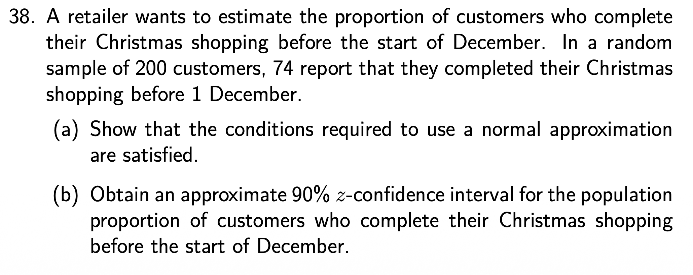

`r hide("Hint")`

`r unhide()`

`r hide("Answer")`

`r unhide()`

`r hide("Solution")`


`r unhide()`

<hr>

## 12 Chi-Squared Goodness-of-fit Test

<hr>


`r hide("Hint")`


`r unhide()`

`r hide("Answer")`

`r unhide()`

`r hide("Solution")`


`r unhide()`


`r hide("Hint")`

`r unhide()`

`r hide("Answer")`


`r unhide()`

`r hide("Solution")`


`r unhide()`

<hr>

## 13 Control Charts

<hr>


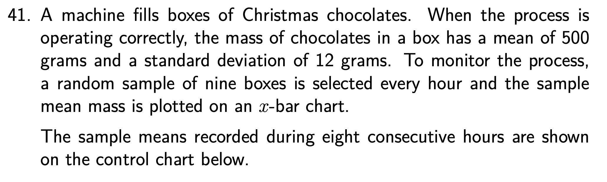

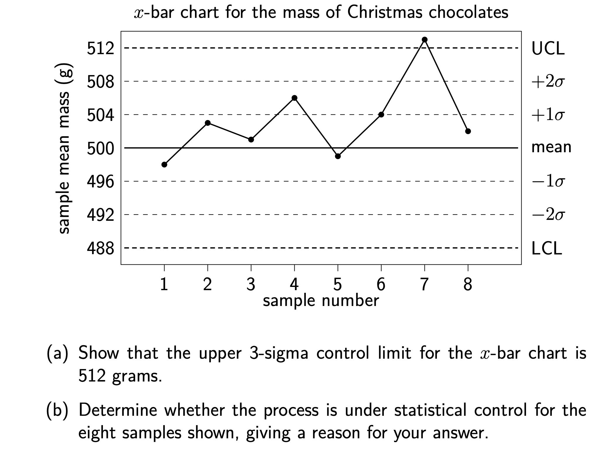

`r hide("Hint")`


`r unhide()`

`r hide("Answer")`


`r unhide()`

`r hide("Solution")`


`r unhide()`


`r hide("Hint")`

`r unhide()`

`r hide("Answer")`

`r unhide()`

`r hide("Solution")`


`r unhide()`


