```{r setup, include = FALSE}
knitr::opts_chunk$set(echo = FALSE)
library(webexercises)
```


```{r, echo = FALSE, results='asis'}
# Uncomment to change widget colours:
#style_widgets(incorrect = "goldenrod", correct = "purple")
```

`r hide("Links")`

[Click here](https://www.sqa.org.uk/files_ccc/ah-statistics-data-booklet.pdf) to open the Data Booklet.

The textbook up to chapter 13 can be found [here](pdf/textbook_to_13.pdf).

`r unhide()`

<hr>

## 1 Exploratory Data Analysis

<hr>


`r hide("Hint")`

`r unhide()`

`r hide("Answer")`


`r unhide()`

`r hide("Solution")`


`r unhide()`


`r hide("Hint")`


`r unhide()`

`r hide("Answer")`


`r unhide()`

`r hide("Solution")`


`r unhide()`


`r hide("Hint")`


`r unhide()`

`r hide("Answer")`


`r unhide()`

`r hide("Solution")`


`r unhide()`

<hr>

## 2 Probability Theory I

<hr>


`r hide("Hint")`


`r unhide()`

`r hide("Answer")`


`r unhide()`

`r hide("Solution")`


`r unhide()`

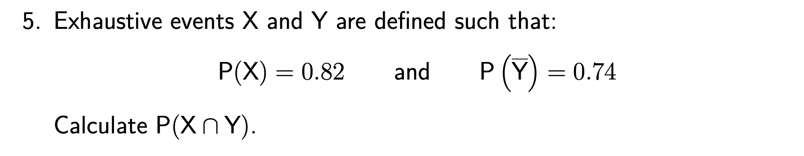

`r hide("Hint")`


`r unhide()`

`r hide("Answer")`


`r unhide()`

`r hide("Solution")`


`r unhide()`


`r hide("Hint")`


`r unhide()`

`r hide("Answer")`


`r unhide()`

`r hide("Solution")`


`r unhide()`


`r hide("Hint")`


`r unhide()`

`r hide("Answer")`


`r unhide()`

`r hide("Solution")`


`r unhide()`

<hr>

## 3 Sampling Theory

<hr>


`r hide("Hint")`


`r unhide()`

`r hide("Answer")`

`r unhide()`

`r hide("Solution")`


`r unhide()`


`r hide("Hint")`

`r unhide()`

`r hide("Answer")`


`r unhide()`

`r hide("Solution")`


`r unhide()`


`r hide("Hint")`

`r unhide()`

`r hide("Answer")`


`r unhide()`

`r hide("Solution")`


`r unhide()`

<hr>

## 4 Probability Theory II

<hr>


`r hide("Hint")`

`r unhide()`

`r hide("Answer")`


`r unhide()`

`r hide("Solution")`


`r unhide()`


`r hide("Hint")`

`r unhide()`

`r hide("Answer")`


`r unhide()`

`r hide("Solution")`


`r unhide()`


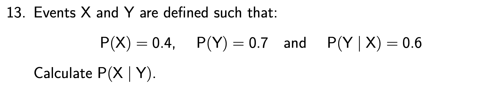

`r hide("Hint")`


`r unhide()`

`r hide("Answer")`


`r unhide()`

`r hide("Solution")`


`r unhide()`


`r hide("Hint")`


`r unhide()`

`r hide("Answer")`


`r unhide()`

`r hide("Solution")`


`r unhide()`

<hr>

## 5 Linear Regression I

<hr>


`r hide("Hint")`


`r unhide()`

`r hide("Answer")`


`r unhide()`

`r hide("Solution")`


`r unhide()`

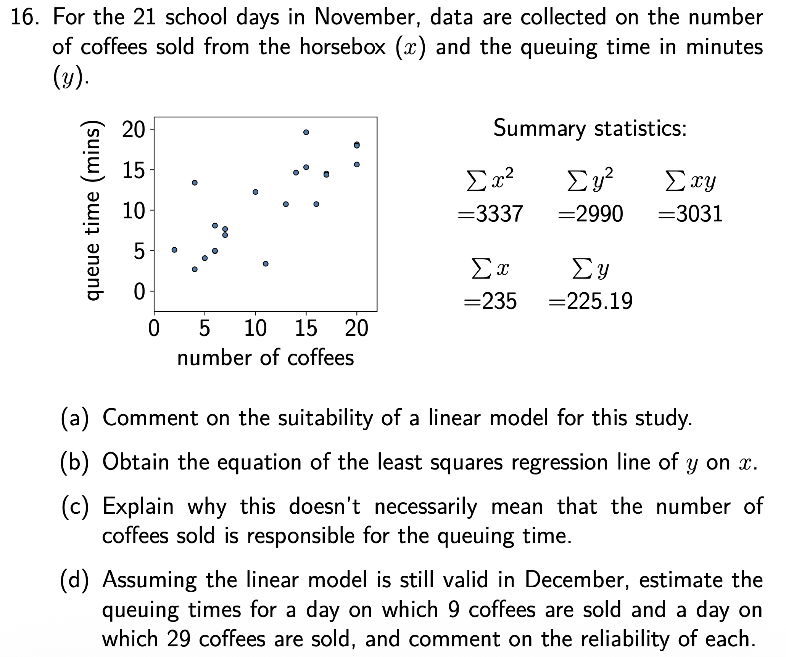

`r hide("Hint")`


`r unhide()`

`r hide("Answer")`


`r unhide()`

`r hide("Solution")`


`r unhide()`

<hr>

## 6 Random Variables

<hr>

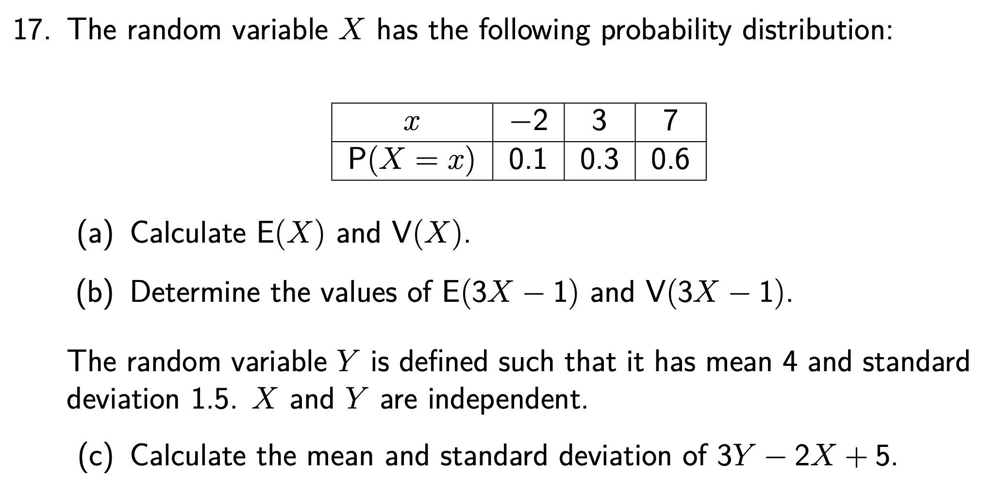

`r hide("Hint")`


`r unhide()`

`r hide("Answer")`


`r unhide()`

`r hide("Solution")`


`r unhide()`


`r hide("Hint")`


`r unhide()`

`r hide("Answer")`


`r unhide()`

`r hide("Solution")`


`r unhide()`

<hr>

## 7 Discrete Distributions

<hr>


`r hide("Hint")`


`r unhide()`

`r hide("Answer")`


`r unhide()`

`r hide("Solution")`


`r unhide()`


`r hide("Hint")`

`r unhide()`

`r hide("Answer")`

`r unhide()`

`r hide("Solution")`


`r unhide()`

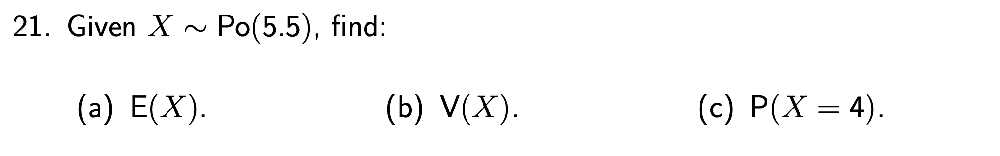

`r hide("Hint")`


`r unhide()`

`r hide("Answer")`

`r unhide()`

`r hide("Solution")`


`r unhide()`


`r hide("Hint")`


`r unhide()`

`r hide("Answer")`


`r unhide()`

`r hide("Solution")`


`r unhide()`


`r hide("Hint")`


`r unhide()`

`r hide("Answer")`


`r unhide()`

`r hide("Solution")`


`r unhide()`

<hr>

## 8 Continuous Distributions

<hr>


`r hide("Hint")`


`r unhide()`

`r hide("Answer")`


`r unhide()`

`r hide("Solution")`


`r unhide()`


`r hide("Hint")`


`r unhide()`

`r hide("Answer")`


`r unhide()`

`r hide("Solution")`


`r unhide()`

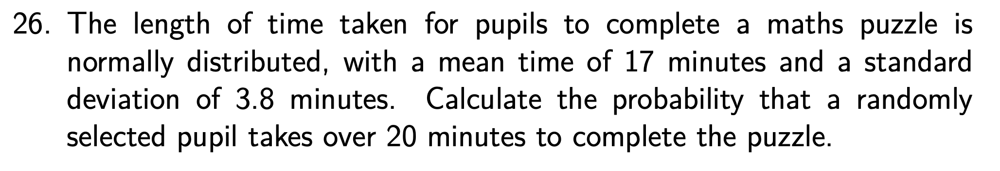

`r hide("Hint")`


`r unhide()`

`r hide("Answer")`


`r unhide()`

`r hide("Solution")`


`r unhide()`


`r hide("Hint")`


`r unhide()`

`r hide("Answer")`


`r unhide()`

`r hide("Solution")`


`r unhide()`

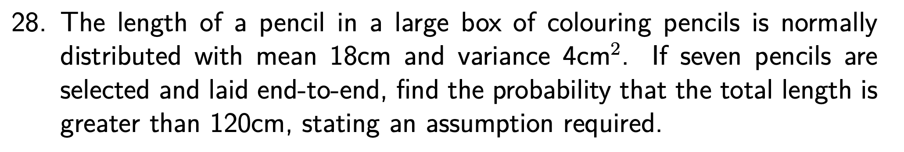

`r hide("Hint")`


`r unhide()`

`r hide("Answer")`

`r unhide()`

`r hide("Solution")`


`r unhide()`

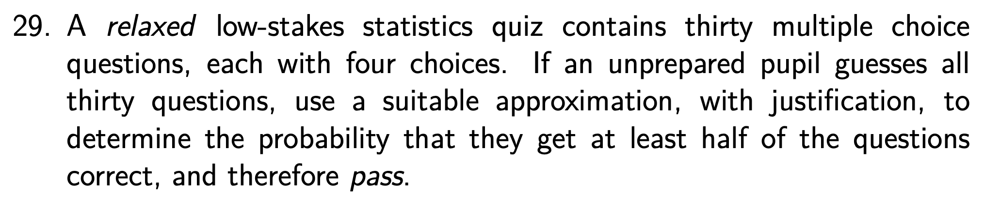

`r hide("Hint")`


`r unhide()`

`r hide("Answer")`


`r unhide()`

`r hide("Solution")`


`r unhide()`


`r hide("Hint")`


`r unhide()`

`r hide("Answer")`


`r unhide()`

`r hide("Solution")`


`r unhide()`

<hr>

## 9 Disribution of the Sample Mean

<hr>


`r hide("Hint")`

`r unhide()`

`r hide("Answer")`


`r unhide()`

`r hide("Solution")`


`r unhide()`

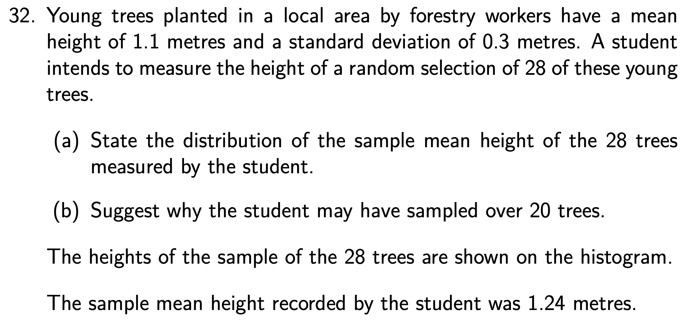


`r hide("Hint")`


`r unhide()`

`r hide("Answer")`


`r unhide()`

`r hide("Solution")`


`r unhide()`

<hr>

## 10 Hypothesis Testing I

<hr>

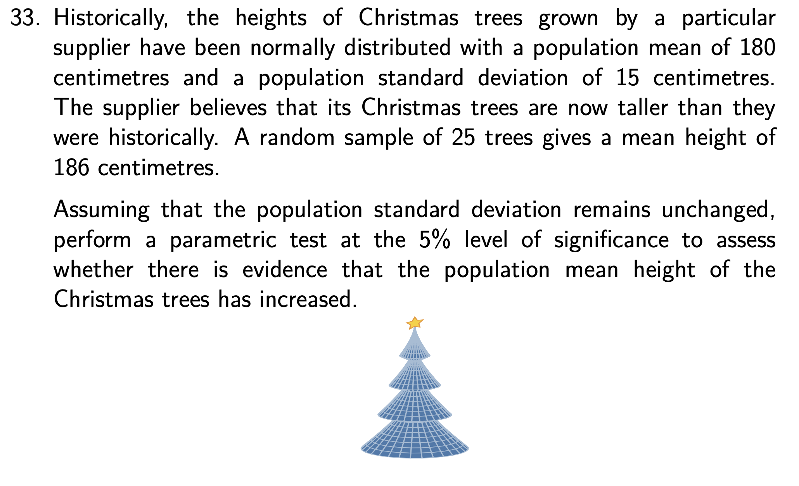

`r hide("Hint")`

`r unhide()`

`r hide("Answer")`


`r unhide()`

`r hide("Solution")`


`r unhide()`

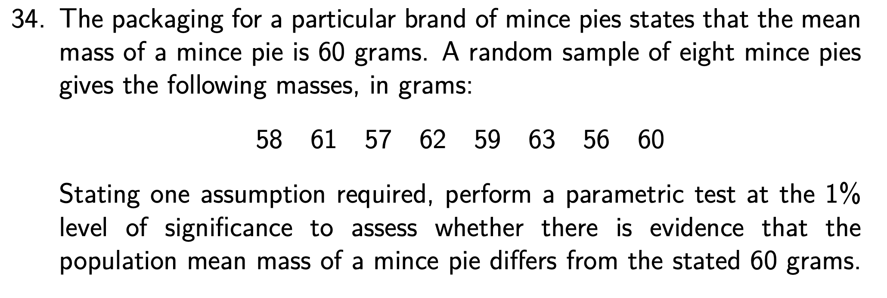

`r hide("Hint")`

`r unhide()`

`r hide("Answer")`

`r unhide()`

`r hide("Solution")`


`r unhide()`

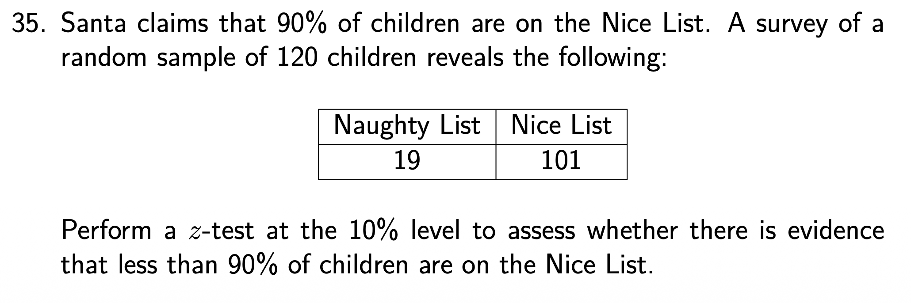

`r hide("Hint")`


`r unhide()`

`r hide("Answer")`


`r unhide()`

`r hide("Solution")`


`r unhide()`

<hr>

## 11 Confidence Intervals

<hr>

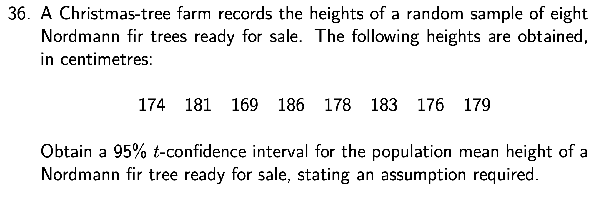

`r hide("Hint")`

`r unhide()`

`r hide("Answer")`


`r unhide()`

`r hide("Solution")`


`r unhide()`

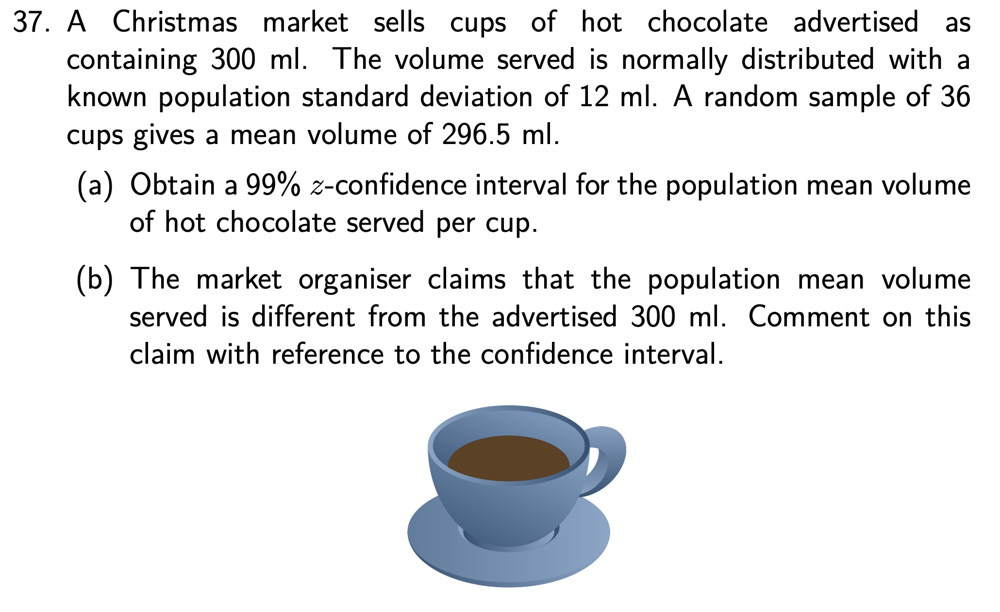

`r hide("Hint")`

`r unhide()`

`r hide("Answer")`


`r unhide()`

`r hide("Solution")`


`r unhide()`


`r hide("Hint")`

`r unhide()`

`r hide("Answer")`

`r unhide()`

`r hide("Solution")`


`r unhide()`

<hr>

## 12 Chi-Squared Goodness-of-fit Test

<hr>

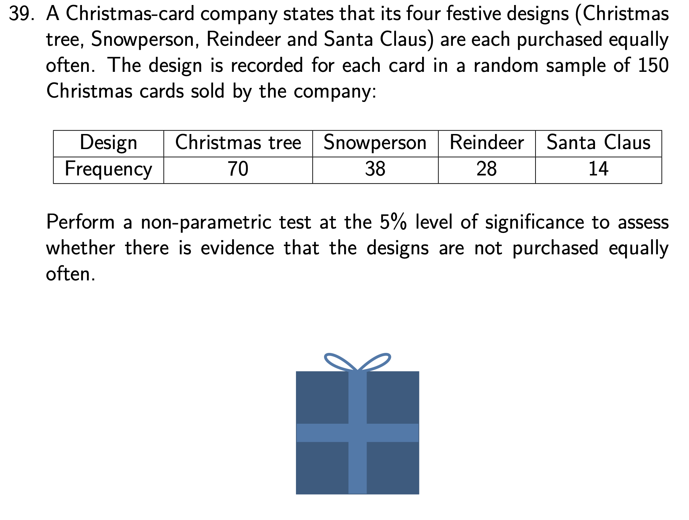

`r hide("Hint")`


`r unhide()`

`r hide("Answer")`

`r unhide()`

`r hide("Solution")`


`r unhide()`


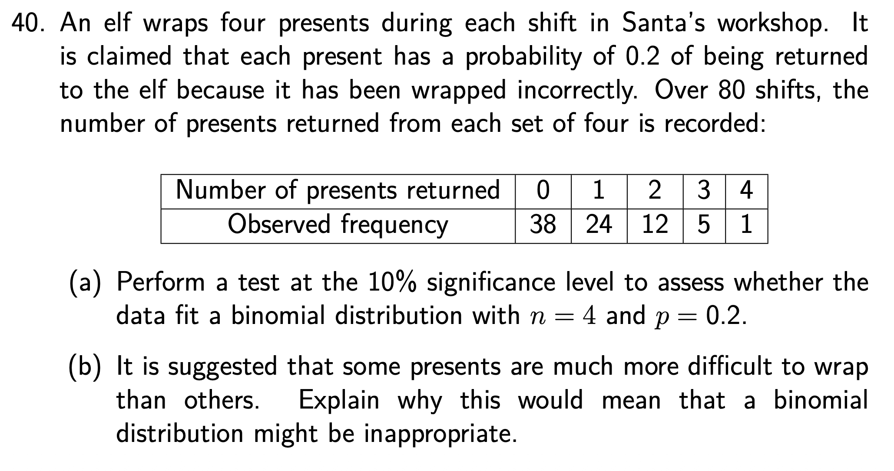

`r hide("Hint")`

`r unhide()`

`r hide("Answer")`


`r unhide()`

`r hide("Solution")`


`r unhide()`

<hr>

## 13 Control Charts

<hr>


`r hide("Hint")`


`r unhide()`

`r hide("Answer")`


`r unhide()`

`r hide("Solution")`


`r unhide()`

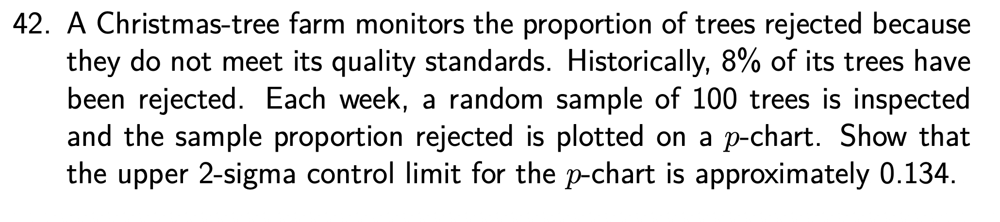

`r hide("Hint")`

`r unhide()`

`r hide("Answer")`

`r unhide()`

`r hide("Solution")`


`r unhide()`


